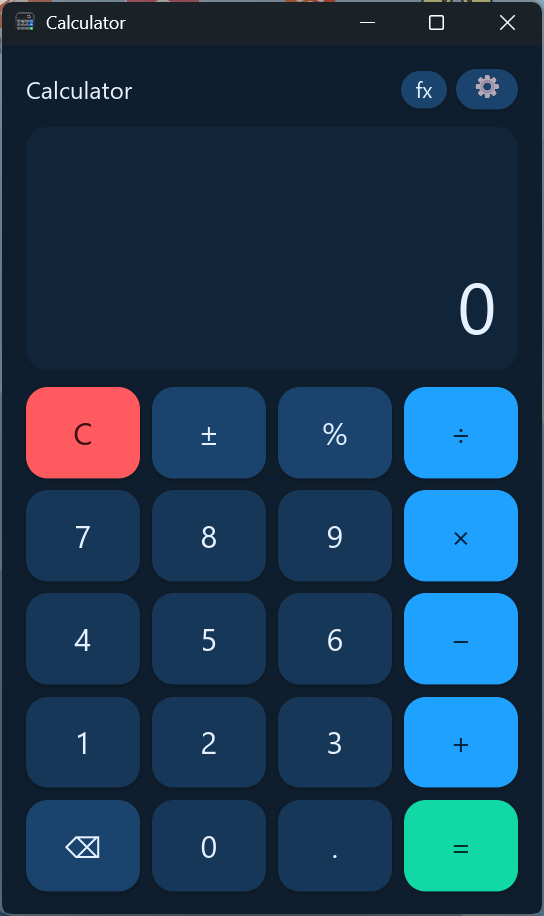
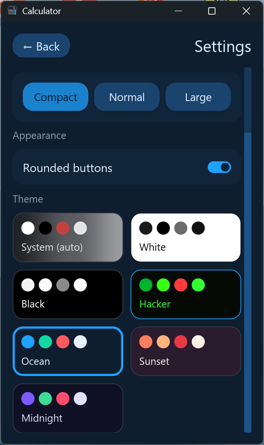
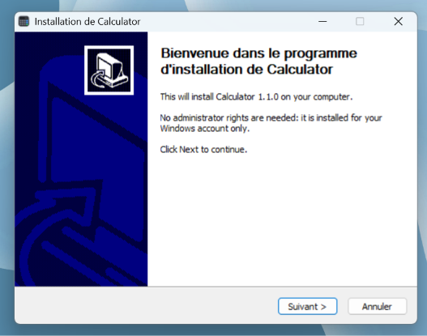

# Calculator

A calculator written in Rust with the [iced](https://github.com/iced-rs/iced) GUI library.
The same code runs on **Windows**, **Linux** and **Android**.

<table>
  <tr>
    <td align="center"></td>
    <td align="center"></td>
  </tr>
  <tr>
    <td align="center">Calculator</td>
    <td align="center">Settings</td>
  </tr>
</table>

## Features

- **Basic and scientific modes**: the **fx** button adds a scientific keypad laid out like the macOS one:
  powers and roots, logarithms, trigonometry (degrees or radians), factorial, π, e, `EE`, random number and memory (`mc` `m+` `m−` `mr`)
- **Correct math order**: `2 + 3 × 4 = 14`, with brackets
- **7 themes**: System (follows Windows light/dark), White, Black, Hacker, Ocean, Sunset and Midnight
- **Compact / Normal / Large size**, and rounded or square buttons
- **Settings are remembered** between launches
- **Keyboard support** on desktop: digits, `+ - * / ^ ( ) !`, `Enter`, `Backspace`, `Esc`
- Long numbers shrink to fit the display; the operator you just pressed stays highlighted

## Download

Get the latest version from the [**Releases**](../../releases/latest) page:

| File | For |
|---|---|
| `calculator-windows-setup.exe` | Windows 10/11 installer (no admin rights needed) |
| `calculator-windows.exe` | Windows, no install: just run it |
| `calculator-linux-x86_64.tar.gz` | Linux, 64-bit |
| `calculator-android.apk` | Android 7.0+ phones (64-bit) |

The files aren't signed, so Windows SmartScreen may warn: choose *More info → Run anyway*.
On Android, allow installing apps from your browser or file manager when asked.

<p align="center"></p>

## Build it yourself

You need [Rust](https://rustup.rs).

**Windows / Linux**

```bash
cargo run --release
```

**Windows installer** (needs [NSIS](https://nsis.sourceforge.io))

```bash
python tools/build_installer.py
```

**Android APK** (needs the Android SDK + NDK, Java and Python with Pillow)

```bash
rustup target add aarch64-linux-android x86_64-linux-android
```
```bash
python tools/build_apk.py
```

## Project layout

| Path | What's in it |
|---|---|
| `src/lib.rs` | The whole app: calculator engine, screens, themes, settings |
| `src/main.rs` | Desktop entry point |
| `vendor/iced_winit` | A copy of `iced_winit` 0.14 with small patches (marked `PATCHED`) so iced can start on Android |
| `tools/` | Scripts to build the APK, the Windows installer and the app icon |
| `installer/calculator.nsi` | The Windows installer script |
| `assets/` | App icon |
